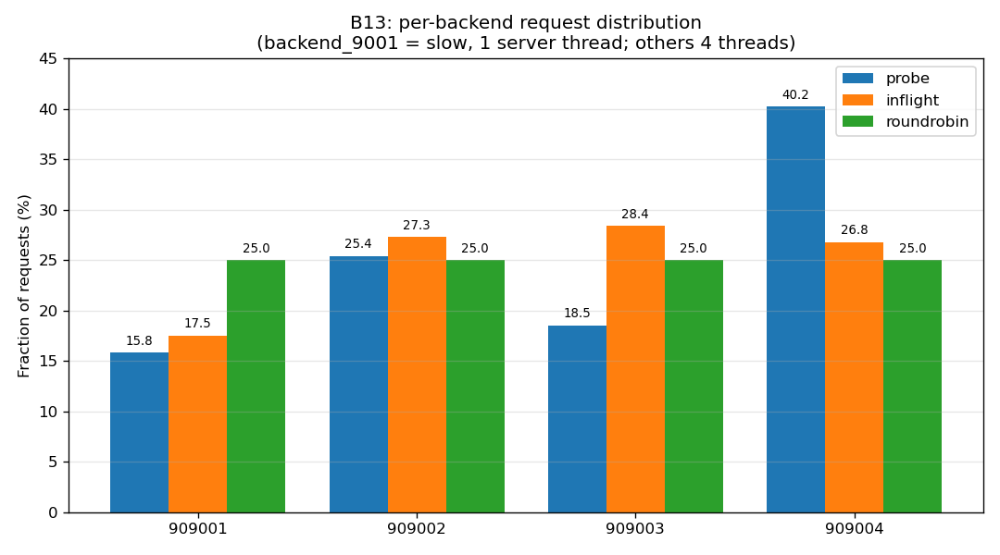
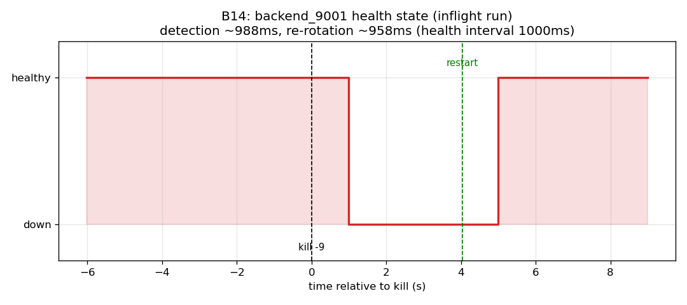

# Part B — Load Balancer: Report

**COL724/7524 Assignment 2, Part B.** A concurrent TCP load balancer fronting
four independent Part A server instances, with health checking and two
state-based selection algorithms plus a round-robin baseline.

---

## 1. Architecture

The LB listens on `load_balancer.port`. The main thread only accepts; each
client connection is handed to its own handler thread, so concurrent clients
never serialize (B4). A handler reads and parses the client's `GET`/`PUT`
header, selects one healthy backend, opens a connection to it, and relays the
exchange transparently (request line → backend; backend response header and
body → client; for `PUT`, the body is relayed client → backend after the
backend's `OK 0` ack). The unmodified Part A client works against the LB with
only the config changed (B2); a `GET` through the LB was verified
byte-identical to the source (md5 match).

Failure semantics (B6): if a backend fails **before** any response byte is
forwarded, the LB replies `ERR <reason>`; if it fails **after** response bytes
have started, the LB closes the client connection and the client observes a
**short read** (the body is a raw byte stream with no room for an error
message). Both paths were verified (pre-response `ERR` on a dead backend; a
one-byte-short read when a backend was killed mid-body-stream).

On `SIGINT`/`SIGTERM` the LB stops accepting, drains in-flight exchanges,
stops its probers, and prints the per-backend forwarded counts (B5).

## 2. Health checking (B7–B10)

One **prober thread per backend** runs the four probes independently, so a
slow or hung probe of one backend never delays the others (B7). Each cycle
sends `HEALTH\n` and reads the reply — the backend's current scheduler queue
depth (B8) — with a timeout of one health interval. A probe fails
(`status=down`) on a connection error, a malformed reply, or no complete reply
within the interval. Every probe is appended to the health log
`timestamp,backend,status,rtt_ms,queue_depth` (B9); a failed probe marks the
backend unhealthy (excluded from selection) and a later successful probe
restores it (B10).

## 3. Selection algorithms (B11–B12)

Two required algorithms that differ in the **kind of state** they read (B12),
plus the allowed stateless round-robin baseline:

* **`probe`** — *probe-cadence state*: picks a healthy backend with the
  minimum **last-reported queue depth** (B8), a value refreshed only once per
  health interval (1 Hz).
* **`inflight`** — *real-time state*: picks a healthy backend with the minimum
  **in-flight request count**, a value updated on every dispatch and
  completion at the LB.
* **`roundrobin`** — stateless baseline; reads no state.

Both least-X algorithms break ties with a round-robin scan among the minima so
no backend is structurally starved; selection is a lock-free single pass over
the backends' atomic state (which also avoids a TOCTOU race that a two-phase
"compute min, then pick among the minima" can hit).

## 4. B13 — Per-backend distribution with a slow backend

Backend `9001` was run with `server_threads=1` against 4 for the other three
(all backends `rr --quantum 4096`), and 1000 load requests (plus 4 seed `PUT`s)
were driven through the LB with the unmodified Part A client. The LB's
per-backend forwarded counts (B5) give the distribution:

| Backend | `probe` | `inflight` | `roundrobin` |
|---|---|---|---|
| 9001 (slow, 1 thread) | **15.8%** | **17.5%** | 25.0% |
| 9002 (fast) | 25.4% | 27.3% | 25.0% |
| 9003 (fast) | 18.5% | 28.4% | 25.0% |
| 9004 (fast) | 40.2% | 26.8% | 25.0% |

* **`roundrobin`** is blind: a perfectly even 25% each, including 25% to a
  4×-slower backend.
* **Both state-based algorithms steer clear of the slow backend** (the least,
  15.8%/17.5%), because a slow backend accumulates queue depth / in-flight
  requests.
* **`inflight`** balances the fast trio tightly (26.8–28.4%) because its
  signal is real-time.
* **`probe`** also avoids the slow backend but **over-serves one fast backend**
  (9004 at 40.2%). This is the between-probes behaviour B13 targets: the queue
  depth is a 1 Hz snapshot, so during each interval the algorithm commits many
  requests to whichever backend the *last* probe showed as least-queued, before
  the load it itself is creating is reflected in the next probe. The slow
  backend's depth only rises after it has accumulated a backlog, so `probe`
  reacts one interval late.

## 5. B14 — Fault injection

In a single run with load in flight (N=5000), backend `9001` was killed with
`kill -9`, then restarted. Detection and re-rotation are bounded by the 1 Hz
probe cadence:

| Algorithm | Detection (kill→down) | Re-rotation (restart→healthy) | Failed requests |
|---|---|---|---|
| `inflight` | 988 ms (~1 interval) | 958 ms (~1 interval) | 3 |
| `roundrobin` | 987 ms (~1 interval) | 960 ms (~1 interval) | 4 |

All failures were confined to the killed backend during the ~1 s detection
window, and split into the two B6 modes:

* **1 pre-response failure** — a new request was routed to the dead backend
  before it was marked unhealthy; the connection was refused, so the client
  got `ERR backend connection failed`. (This request is also what marks the
  backend unhealthy immediately, ahead of the next probe.)
* **2–3 post-response failures** — exchanges already in flight when the backend
  was killed; the client received a short read (fewer bytes than declared).

After the prober marks the backend `down` (~1 interval), selection excludes it
and no further failures occur; after restart, it re-enters rotation on the next
successful probe (~1 interval). A **non-zero** failure count is expected here.
Reaching **zero** would require (a) retrying a pre-response failure on another
healthy backend before replying to the client, and (b) client-side retries for
in-flight short reads — neither is required by the spec, and (b) cannot be done
by the LB alone because response bytes were already sent.

## 6. Trade-offs between the two algorithms

* **`inflight` (real-time)** reacts on every dispatch/completion, so it
  balances closely and avoids a slow backend promptly. Its weakness: in-flight
  is a *local* view of work the LB sent, not the backend's actual load, and a
  freshly-restarted or idle backend (in-flight 0) can look attractive until the
  health check or real work catches up.
* **`probe` (probe-cadence)** reads the backend's *actual* scheduler queue
  depth, a more direct load signal, but only as fresh as the last probe. It
  therefore lags by up to one interval, over-serving a backend between probes
  (B13's 40% spike) and only avoiding a slow/dead backend after the next probe.
* Both rely on the same health check for liveness, so both are bounded by the
  ~1-interval detection/re-rotation latency of B14; the difference is in how
  they *distribute* load to healthy backends, not in how fast they drop a dead
  one.

**Design choices** (per the ground rules): all four backends share one `--file`
directory (transparent LB, no sticky sessions, so every backend must serve every
file); the LB does not retry a pre-response failure (strict B6); the health log
uses epoch-ms timestamps, `queue_depth=-1` for failed probes, and integer-ms RTT.
